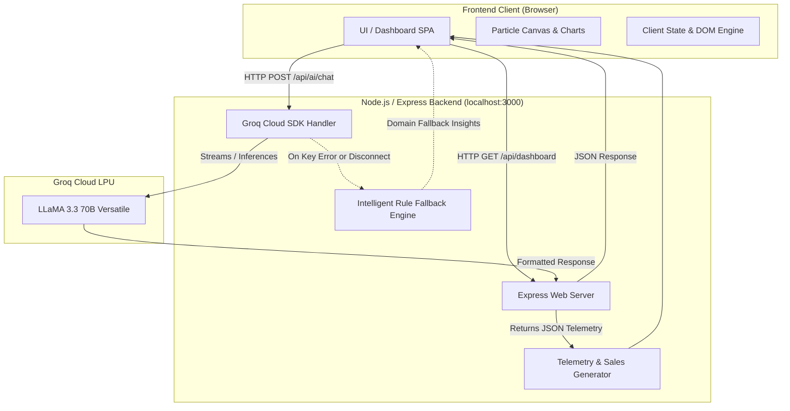

# 🏎️ ApexDrive — AI-Powered Retail Sales & Fleet Operations Telemetry Dashboard

[](https://nodejs.org/)
[](https://expressjs.com/)
[](https://groq.com/)
[](https://www.chartjs.org/)
[](https://tailwindcss.com/)
[](LICENSE)

An enterprise-grade, high-octane automotive aftermarket parts retail analytics and warehouse logistics telemetry dashboard. **ApexDrive** combines real-time operational metrics with ultra-low-latency AI intelligence powered by **Groq Cloud (LLaMA 3.3 70B Versatile)** to deliver automated business insights, predictive demand forecasting, and interactive operational advisory.

---

## 📌 Table of Contents

- [Project Overview](#-project-overview)
- [Key Features](#-key-features)
- [Tech Stack & Architecture](#-tech-stack--architecture)
- [System Architecture & Data Flow](#-system-architecture--data-flow)
- [Directory Structure](#-directory-structure)
- [API Endpoints](#-api-endpoints)
- [Getting Started & Installation](#-getting-started--installation)
- [AI Engine & Groq Integration](#-ai-engine--groq-integration)
- [Presentation & Demo Guide](#-presentation--demo-guide)
- [Future Enhancements](#-future-enhancements)

---

## 🌟 Project Overview

Traditional retail dashboards often present static numbers without contextual operational advice. **ApexDrive** bridges telemetry and generative AI by simulating a complex, multi-warehouse automotive parts distribution network (covering Detroit, Dallas, Los Angeles, Atlanta, and Frankfurt) and combining:
1. **Financial & Sales Telemetry:** Monthly gross revenue, margins, average order values (AOV), and seasonal automotive demand trends.
2. **Supply Chain & Logistics:** Multi-hub fulfillment speeds, fleet on-time delivery rates, and garage account satisfaction.
3. **Generative AI Advisory:** Real-time analysis via **Groq's LPU™ (Language Processing Unit)**, providing C-suite executive summaries, restocking recommendations, and interactive AI consultation.

---

## 🚀 Key Features

### 1. Operations Overview Deck (`/`)
- Dynamic KPI counters: Gross Revenue ($1.8M+), YoY Growth (+18.4%), Dispatch Volume (42k+ orders), Account Retention (86.4%), and RMA Warranty rates (<0.9%).
- Interactive Chart.js graphs: Monthly revenue vs. prior year, Category share doughnut, Daily dispatch velocity.
- Animated dynamic background with custom particle physics (HTML5 Canvas) and ambient aurora effects.

### 2. Fleet Revenue & Seasonal Analytics
- Toggle between **Monthly Revenue**, **YoY Comparative Growth**, and **Rolling 30-Day Velocity**.
- Seasonal automotive demand modeling (Spring tuning surges, track-day prep, and Q4 fleet rebuilds).

### 3. Parts Catalog & Inventory Management
- Rich parts catalog categorized across 8 automotive sectors (Turbo & Powertrain, Carbon-Ceramic Braking, Track Suspensions, etc.).
- Real-time stock alerts (High Demand, Active Fast-Mover, Special Order).
- Dynamic search and category filtering with deep-linked SKU detail modal drawers.

### 4. Garage & Commercial Accounts Portal
- Segmentation analysis: Commercial Dealership Fleets, Independent Speedshops, Fleet Maintenance, DIY Tuners, and Wholesale OEM Distributors.
- Customer behavior, average spend, lifetime order volumes, and retention tracking.

### 5. Warehouse Logistics & Hub Telemetry
- Real-time telemetry across 5 distribution hubs:
  - **Detroit Central Mega-Hub (HUB-DTW)**
  - **Dallas Logistics Depot (HUB-DFW)**
  - **Los Angeles Port Speedshop (HUB-LAX)**
  - **Atlanta Regional Warehouse (HUB-ATL)**
  - **Frankfurt Euro-Import Hub (HUB-FRA)**
- Fulfillment transit speeds, dispatch reliability, and on-time performance metrics.

### 6. ApexGear AI Assistant (Powered by Groq Cloud)
- **Natural Language Data Querying:** Ask questions regarding inventory bottlenecks, regional performance, or margins.
- **Ultra-Fast LLM Inference:** Powered by `llama-3.3-70b-versatile` (with fallback to `llama-3.1-8b-instant`).
- **Dynamic API Key Management:** Add or change Groq API keys on the fly from the UI with real-time handshake validation.
- **Fail-Safe Offline Mode:** Intelligent automotive analytics fallback engine ensures zero downtime even when offline.

### 7. AI Predictive Demand Forecasting
- Mathematical and LLM-assisted 3-month predictive sales modeling.
- Seasonal adjustment factors, inventory risk ratings, and strategic supplier pre-order alerts.

### 8. Live Operational Dispatch Alerts
- Slide-out alert drawer providing live notifications on low-stock warnings, freight dispatches, and warranty rate thresholds.

---

## 🛠️ Tech Stack & Architecture

### **Frontend (Client-Side)**
- **Markup:** Semantic HTML5 with custom modal drawers and responsive sub-page navigation.
- **Styling:** 
  - **Tailwind CSS v3 (Standalone Engine):** Custom motorsport-themed design tokens (`apex-cyan`, `apex-orange`, `apex-obsidian`).
  - **Vanilla CSS3:** Glassmorphism, backdrop filters, CSS keyframe glow pulses, and neon radiant borders.
- **Logic & DOM Manipulation:** Native Modern JavaScript (ES6+ Modules, Async/Await, Fetch API).
- **Data Visualizations:** **Chart.js v4 (UMD)** with customized dark-mode glowing line charts, bar charts, and radar charts.
- **Iconography:** **Remix Icon v4** for crisp vector icons.
- **Canvas Visuals:** HTML5 Canvas API particle physics engine with cyan and amber particle nodes.

### **Backend (Server-Side)**
- **Runtime Environment:** **Node.js (v18+)**
- **Web Framework:** **Express.js (v4.18.2)**
- **Cross-Origin Resource Sharing:** `cors` middleware
- **Environment Configuration:** `dotenv` for secure environment variable isolation
- **AI SDK:** `@groq/groq-sdk` for communication with Groq’s high-speed inference cloud.

### **Artificial Intelligence & LLMs**
- **Primary Model:** `llama-3.3-70b-versatile` hosted on Groq Cloud LPUs.
- **Secondary / Fallback Model:** `llama-3.1-8b-instant`.
- **System Architecture:** Prompt-engineered domain context injection with automotive telemetry summaries.

---

## 📊 System Architecture & Data Flow



---

## 📁 Directory Structure

```text
retail_sales_analytics_dashboard/
├── .env                        # Environment variables (GROQ_API_KEY, PORT)
├── package.json                # Project dependencies and npm scripts
├── package-lock.json           # Exact dependency lockfile
├── server.js                   # Node.js backend server, APIs, & AI logic
├── START.bat                   # 1-Click launcher script (installs deps & starts server)
├── run_dashboard.bat           # Alternative quick launch script
├── README.md                   # Project documentation & presentation guide
└── public/                     # Static frontend assets
    ├── index.html              # Main Single Page Application structure
    ├── app.js                  # Frontend state management, charts, and AI calls
    ├── style.css               # Bespoke glassmorphism CSS & animations
    ├── bg-*.jpg                # Optimized high-resolution thematic backgrounds
    └── libs/                   # Self-contained offline libraries
        ├── chart.umd.min.js    # Chart.js visualization engine
        ├── tailwind.js         # Offline standalone Tailwind CSS engine
        └── remixicon/          # Remix Icon vector stylesheets and fonts
```

---

## 🔌 API Endpoints

| Method | Endpoint | Description |
|---|---|---|
| `GET` | `/api/dashboard` | Fetches complete sales telemetry, KPIs, top SKUs, and hub metrics. |
| `POST` | `/api/refresh` | Regenerates dynamic operational data with randomized realistic variations. |
| `GET` | `/api/status` | Returns the status of the Groq API key and current active model. |
| `POST` | `/api/set-api-key` | Live-tests and persists a new Groq API key into `.env`. |
| `POST` | `/api/remove-api-key`| Disconnects Groq key and returns server to hybrid demo mode. |
| `POST` | `/api/ai/insights` | Generates executive AI operational insights via Groq LLaMA 3.3. |
| `POST` | `/api/ai/chat` | Conversational endpoint for interactive questions about the business. |
| `POST` | `/api/ai/forecast` | Generates a 3-month AI predictive sales forecast with rationales. |

---

## ⚙️ Getting Started & Installation

### Prerequisites
- [Node.js](https://nodejs.org/) (Version 18.x or later installed)
- A modern web browser (Google Chrome, Edge, Brave, Firefox)
- *(Optional)* Free Groq API Key from [console.groq.com](https://console.groq.com)

### 1-Click Launch (Windows)
Double-click **`START.bat`**. This script will:
1. Verify Node.js installation.
2. Run `npm install` automatically if `node_modules` is missing.
3. Launch the web application in your default browser at `http://localhost:3000`.

### Manual Setup via Terminal
```bash
# 1. Clone or navigate to the repository
cd retail_sales_analytics_dashboard

# 2. Install dependencies
npm install

# 3. Configure environment (optional, can also be configured inside UI)
# Edit .env file and add your GROQ_API_KEY
# GROQ_API_KEY=gsk_your_key_here
# PORT=3000

# 4. Start the application
npm start
# or
node server.js
```

Open your browser at `http://localhost:3000`.

---

## 🤖 AI Engine & Groq Integration

1. **Why Groq?** Groq utilizes custom silicon called LPUs (Language Processing Units), achieving speeds upwards of **500+ tokens per second**, allowing near-instant AI responses compared to traditional GPU cloud APIs.
2. **Context-Aware Prompting:** The server injects live data points (Revenue, Gross Margin, On-Time Delivery rates, Top SKUs) into the system prompt, preventing hallucination and ensuring accurate answers.
3. **Resilience & Fallback:** If an API key is not supplied or network connectivity drops, the system gracefully switches to a rule-based intelligent fallback engine that maintains full interactive functionality.

---

## 🎓 Presentation & Demo Guide (For Class Presentation)

Use this quick-reference table during your live demonstration:

| Slide / Section | What to Show on Screen | Key Points to Speak |
|---|---|---|
| **1. Intro & Hook** | Splash Screen (`APEXDRIVE`) | Introduce the problem: modern automotive aftermarket supply chains need real-time data combined with instant actionable AI intelligence. |
| **2. Operations Deck** | Overview Deck + KPI Grid | Highlight real-time KPIs ($1.8M revenue, 98.2% on-time dispatch), Chart.js visual breakdowns, and the custom particle canvas engine. |
| **3. Parts & Warehouses** | Parts Catalog & Hub Telemetry | Demonstrate the 8 automotive part categories, low-stock warnings, SKU filtering, and 5 regional distribution hubs. |
| **4. Groq AI Integration** | ApexGear AI Chat & Demand Forecast | Click on **ApexGear AI**, ask a question (e.g., *"What is our top selling SKU?"* or *"Predict next quarter's revenue"*). Emphasize Groq LPU's sub-second response time with LLaMA 3.3 70B. |
| **5. Technical Architecture** | Codebase (`server.js` + `app.js`) | Explain the clean separation of concerns: Express.js backend handling REST APIs and Groq SDK, with a lightweight, responsive client-side SPA. |

---

## 🌐 How to Deploy the Project Live (Cloud Deployment)

ApexDrive is built with Node.js and Express, listening on `process.env.PORT || 3000`. It is 100% production-ready for deployment to modern cloud platforms.

### Option 1: Deploy to Render (Recommended — Free & Easiest)
1. **Push your code to GitHub:**
   ```bash
   git init
   git add .
   git commit -m "Initial commit of ApexDrive"
   git branch -M main
   git remote add origin https://github.com/your-username/retail-sales-analytics-dashboard.git
   git push -u origin main
   ```
2. **Go to [render.com](https://render.com/)** and sign in with GitHub.
3. Click **New +** → **Web Service**.
4. Connect your `retail-sales-analytics-dashboard` repository.
5. Configure the deployment settings:
   - **Name:** `apexdrive-telemetry` (or any name)
   - **Environment:** `Node`
   - **Build Command:** `npm install`
   - **Start Command:** `npm start` (or `node server.js`)
   - **Instance Type:** `Free`
6. Under **Environment Variables**, add:
   - `GROQ_API_KEY` = `gsk_your_groq_api_key`
   - `NODE_ENV` = `production`
7. Click **Deploy Web Service**. Within 2 minutes, you will get a live public HTTPS URL (e.g., `https://apexdrive-telemetry.onrender.com`) to share with your class!

---

### Option 2: Deploy to Railway
1. Go to [railway.app](https://railway.app/) and sign in.
2. Click **New Project** → **Deploy from GitHub repo**.
3. Select this repository.
4. Go to **Variables** tab and add `GROQ_API_KEY`.
5. Railway will automatically detect `package.json`, install dependencies, and launch your server.
6. Under **Settings** → **Networking**, click **Generate Domain** to get your public URL.

---

## 📄 License
This project is licensed under the MIT License. Developed for educational, commercial telemetry, and performance demonstration purposes.

